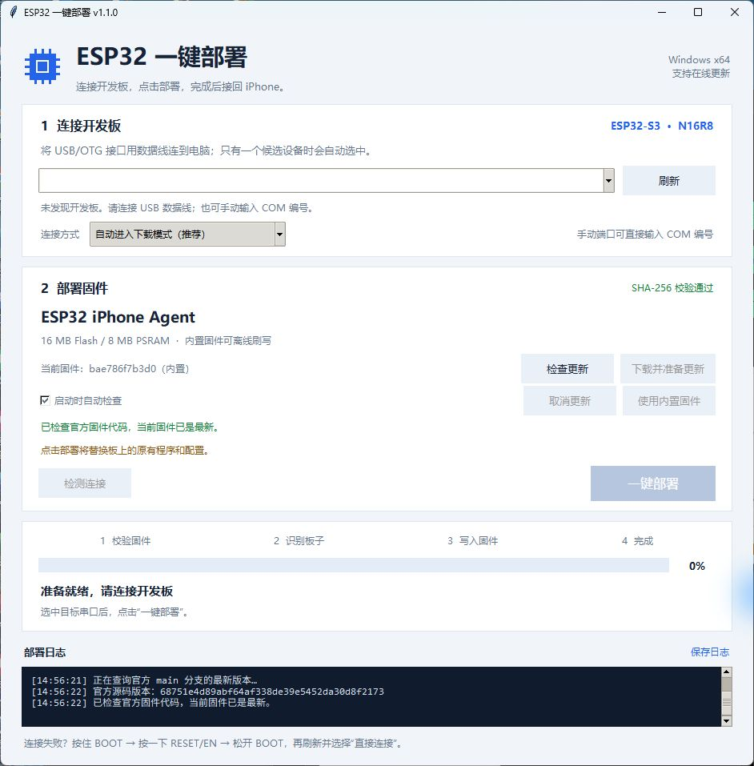

# Windows 一键部署工具 v1.1.0

在 Windows 上，为 **ESP32-S3 N16R8（16 MB Flash / 8 MB OPI PSRAM）** 刷入 ESP32 Agent 固件。完整解压便携包后即可运行，使用内置固件时无需安装 Python、Arduino IDE 或 Git。

本工具是独立项目 [TTTAAXXTTT/esp32-oneclick-deployer](https://github.com/TTTAAXXTTT/esp32-oneclick-deployer)，提供 Windows 图形部署工具。原始 ESP32 iPhone Agent 项目由 **Henry（[@iamhenryyuan](https://x.com/iamhenryyuan) / [onehumanbeing](https://github.com/onehumanbeing)）** 开发；请先了解[原作者项目](https://github.com/onehumanbeing/esp32-iphone-agent)。Windows 图形工具、打包和更新功能由 TTTAAXXTTT（原 WS08）维护，本发布不代表原作者官方发布或背书。

## 下载

前往 [v1.1.0 发布页](https://github.com/TTTAAXXTTT/esp32-oneclick-deployer/releases/tag/v1.1.0)：

| 文件 | 用途 |
| --- | --- |
| `ESP32-OneClick-N16R8-Windows-x64-v1.1.0.zip` | Windows 10/11 x64 便携软件，包含运行环境、内置固件和对应源码 |
| `ESP32-OneClick-Source-v1.1.0.zip` | 完整源码归档，用于阅读、修改及重新构建 |
| `SHA256SUMS.txt` | 发布附件的 SHA-256 校验值 |

仓库根目录直接提供工具源码、测试与构建脚本。克隆或下载本仓库后，先运行 `python prepare-build-inputs.py` 下载并校验两个构建输入，再按 [构建说明](../SOURCE-BUILD.md) 打包。Release 的完整源码附件已包含这两个输入。

## 软件界面



上方选择串口和连接方式；中间查看内置固件、检查更新或准备新版固件；下方显示部署阶段和日志。只有点击「一键部署」后才会写入开发板。

## 第一次部署


1. **完整解压 ZIP**，双击 `ESP32-OneClick.exe`。保留同目录的 `_internal`、许可证和源码文件夹。
2. 将开发板与手机断开，用 USB **数据线**把开发板的 **USB/OTG** 口连接电脑。双 USB 口开发板上的 `UART/COM` 是另一接口，请先使用原生 `USB/OTG` 口。
3. 点击「刷新」，选择开发板的 COM 端口。关闭其他占用该串口的软件。
4. 确认板上旧程序和配置可以被覆盖，点击「一键部署」。工具会识别芯片、核对容量与固件哈希，然后写入并校验。
5. 等待界面显示部署成功，日志中应有 `Hash of data verified.`。按一下 **RESET/EN**，再将 **USB/OTG** 接回已解锁的 iPhone。
6. 在 iPhone 上打开 ESP32 Agent，继续完成蓝牙连接、镜像和模型 API 配置。手机 App 的完整用法见[原项目说明](https://github.com/onehumanbeing/esp32-iphone-agent/blob/main/README.zh-CN.md)。

**固件刷写成功仅表示板上固件已写入并通过校验。** 蓝牙配对、屏幕镜像与手机 App 连接仍需分别完成；本工具不代替手机 App。

若无法自动进入下载模式：按住 **BOOT** → 按一下 **RESET/EN** → 松开 **BOOT**，等待串口出现后刷新选择，并切换到手动下载模式。找不到串口时先更换数据线、USB 接口，再检查设备管理器。

## v1.1.0 的固件更新

默认在启动时检查原作者仓库的 `main` 分支，保持打开时每 6 小时再检查一次；也可点击「检查更新」或取消自动检查。

更新流程是 **检查官方源码 → 下载并准备更新 → 一键部署**：

- 固定官方提交后比较 `hardware/hid_bridge` 的内容，仅文档或 iPhone App 修改不会触发板子固件更新。
- 点击「下载并准备更新」后，工具下载对应源码并在本机编译，生成完整的 N16R8 固件镜像，再校验结构和 SHA-256。
- **首次约需下载 2 GB 工具链，并占用数 GB 磁盘空间**；后续会复用依赖。准备完成后仍需点击「一键部署」才会写入板子。
- 下载或编译失败时保留当前可用固件；也可选择「使用内置固件」。iPhone App 更新需要单独安装，仓库中的 iOS 云端构建工作流也需单独运行。

固定构建依赖：Arduino CLI **1.5.1**、Arduino ESP32 core **3.3.12**、NimBLE-Arduino **2.5.1**；使用项目的 `nimble_cfg.h`，目标配置为：

```text
esp32:esp32:esp32s3:USBMode=default,CDCOnBoot=cdc,FlashSize=16M,PSRAM=opi,PartitionScheme=default_8MB
```

官方未来若改变协议、依赖或分区格式，可能需要同步更新工具或 iPhone App。

## 验证范围

- 已通过 **68 项自动化测试**、独立 EXE 自检和实际界面检查。
- 已验证官方更新检查；本次发布时，内置固件与检查到的官方固件源码一致。
- 内置 N16R8 固件已有实板写入及哈希校验成功记录。
- **从发现新版到完整下载工具链、编译并刷写的更新流程，尚未做完整实测；手机 Agent 的完整操作闭环也未作为本发布的验证结果。**

日志保存在 `%LOCALAPPDATA%\ESP32OneClick\logs`；设置和更新缓存位于同一应用数据目录。报告问题时可附相关日志，先检查其中是否含有不希望公开的设备标识。

## 来源与许可证

感谢原作者及所有上游维护者。不同组件保留各自许可证：

| 组件 | 来源 / 许可证 |
| --- | --- |
| ESP32 iPhone Agent 原项目 | [onehumanbeing/esp32-iphone-agent](https://github.com/onehumanbeing/esp32-iphone-agent)，原有 [MIT 声明](https://github.com/onehumanbeing/esp32-iphone-agent/blob/main/LICENSE) 保留 |
| AirPlay 部分及链接后的完整固件 | GPL-3.0；完整固件与对应源码一同分发 |
| 本 Windows 部署工具 | [GPL-3.0（源码包内 LICENSE）](ESP32-OneClick-Repository-Source-v1.1.0.zip) |
| esptool 5.1.0 | [espressif/esptool](https://github.com/espressif/esptool/tree/v5.1.0)，GPL-2.0-or-later |
| Arduino CLI 1.5.1 | [arduino/arduino-cli](https://github.com/arduino/arduino-cli/tree/v1.5.1)，GPL-3.0 |

便携包内提供许可证、第三方声明及对应源码；重新分发时应一并保留。源码归档和仓库中的构建说明记录固件来源、工具版本及重新生成方法。
