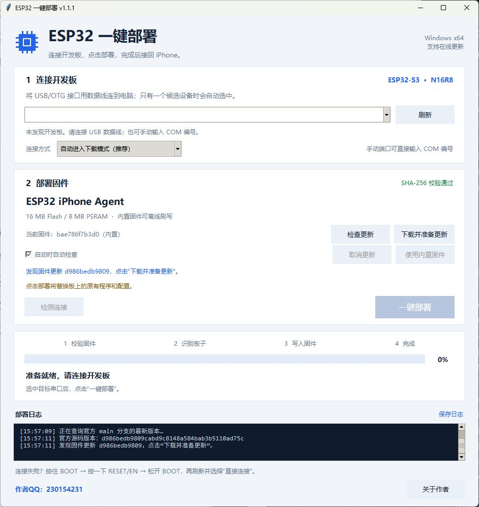
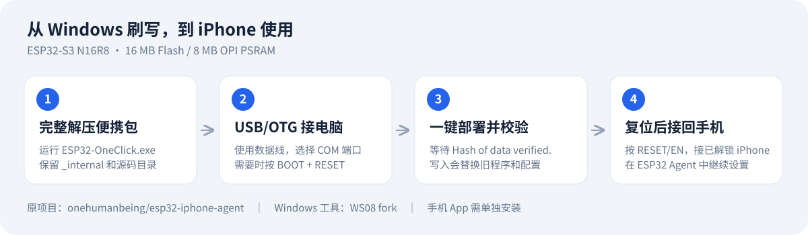

# ESP32 OneClick Deployer

**Windows 一键部署 ESP32-S3 N16R8**：图形刷写、固件完整性校验、官方固件自动检查和下载构建。

这是 TTTAAXXTTT 维护的独立项目，源码、测试和构建脚本直接放在本仓库。适用 Windows 10/11 x64；目标开发板为 **16 MB Flash / 8 MB OPI PSRAM**。

[下载 v1.1.1 软件与完整源码](https://github.com/TTTAAXXTTT/esp32-oneclick-deployer/releases/tag/v1.1.1) · [中文图文指南](docs/GUIDE.zh-CN.md) · [从源码构建](SOURCE-BUILD.md)



## 作者与联系

**作者QQ：230154231**

Windows 一键部署工具由 TTTAAXXTTT 维护。主界面底部常驻显示 QQ；点击「关于作者」可再次查看。此联系方式属于本 Windows 工具维护者，原始固件与手机项目作者见下方致谢。

## 使用方法



1. 下载并完整解压 `ESP32-OneClick-N16R8-Windows-x64-v1.1.1.zip`，保留 `_internal` 等附带目录，运行 `ESP32-OneClick.exe`。
2. 用 USB 数据线将板子的 **USB/OTG** 口接电脑，选择 COM 端口，确认可以覆盖原有程序后点击「一键部署」。
3. 等待写入与哈希校验成功，按 RESET/EN，再将 USB/OTG 接回已解锁的 iPhone。
4. 在单独安装的 ESP32 Agent 手机 App 中继续配对和配置模型 API。

找不到端口时：按住 BOOT → 按一下 RESET/EN → 松开 BOOT，然后刷新端口。

## 固件更新

启动时默认检查原作者仓库，保持打开时每 6 小时再检查一次。只比较固件目录，避免把文档或手机 App 修改误报为固件更新。

发现更新后点击「下载并准备更新」，工具会固定官方提交、下载源码并按 N16R8 参数构建。首次约需下载 2 GB 工具链，之后复用依赖；准备完成后仍需点击「一键部署」才写入开发板。

## 开发与构建

使用带 Tkinter 的 Python 3.12（支持 3.10+）：

```powershell
python -m venv .venv
.\.venv\Scripts\python.exe -m pip install -r requirements.txt
.\.venv\Scripts\python.exe prepare-build-inputs.py
.\build.ps1 -Python .\.venv\Scripts\python.exe
```

完整源码 Release 附件已带齐构建输入，可跳过准备输入一步。运行测试：

```powershell
.\.venv\Scripts\python.exe -m unittest discover -s tests -v
```

| 路径 | 内容 |
| --- | --- |
| `main.py` | Windows 图形界面 |
| `deployer_core.py` | 串口识别、固件校验与刷写 |
| `updater.py` | 官方源码检查与本机构建 |
| `tests/` | 68 项原有自动化测试 |
| `source/firmware/` | 对应固件首选源码与编译参数 |
| `source/third-party/`、`licenses/` | 第三方对应源码及许可证 |
| `docs/` | 图文使用说明 |

不将固件二进制和 Arduino CLI EXE 存入 Git 历史；准备脚本从本项目的完整源码附件读取它们，并按 manifest 校验 SHA-256。软件运行不需要 GitHub 登录。

## 验证范围

v1.1.1 已通过 68 项自动化测试、冻结 EXE 自检及界面检查；内置固件已有 N16R8 实板写入和哈希校验记录。**新版固件下载、完整工具链安装、编译和刷写更新流程尚未完成完整实测。** 手机蓝牙、镜像和模型操作需要在实际设备上继续验证。

## 原作者与许可证

ESP32 iPhone Agent 原始项目由 **Henry（[onehumanbeing](https://github.com/onehumanbeing) / [@iamhenryyuan](https://x.com/iamhenryyuan)）** 开发，来源：[onehumanbeing/esp32-iphone-agent](https://github.com/onehumanbeing/esp32-iphone-agent)。感谢原作者提供固件及手机端项目。本独立仓库由 TTTAAXXTTT 维护 Windows 部署工具，不代表原作者官方发布或背书。

本工具为 GPL-3.0；保留原项目 MIT 声明，AirPlay 部分及相应完整固件按 GPL-3.0 分发。esptool 为 GPL-2.0-or-later，Arduino CLI 为 GPL-3.0。完整许可与第三方声明见 `LICENSE`、`licenses/` 和对应源码目录。

